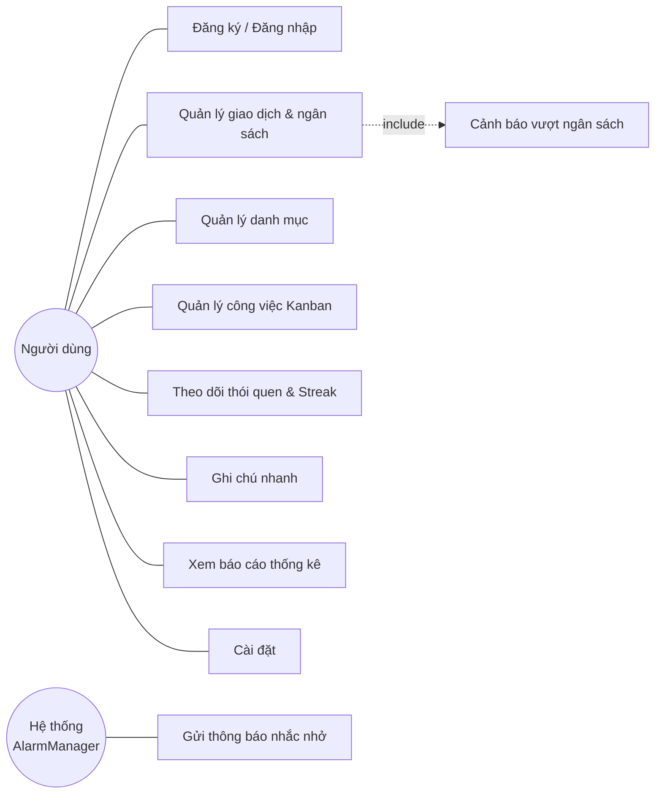
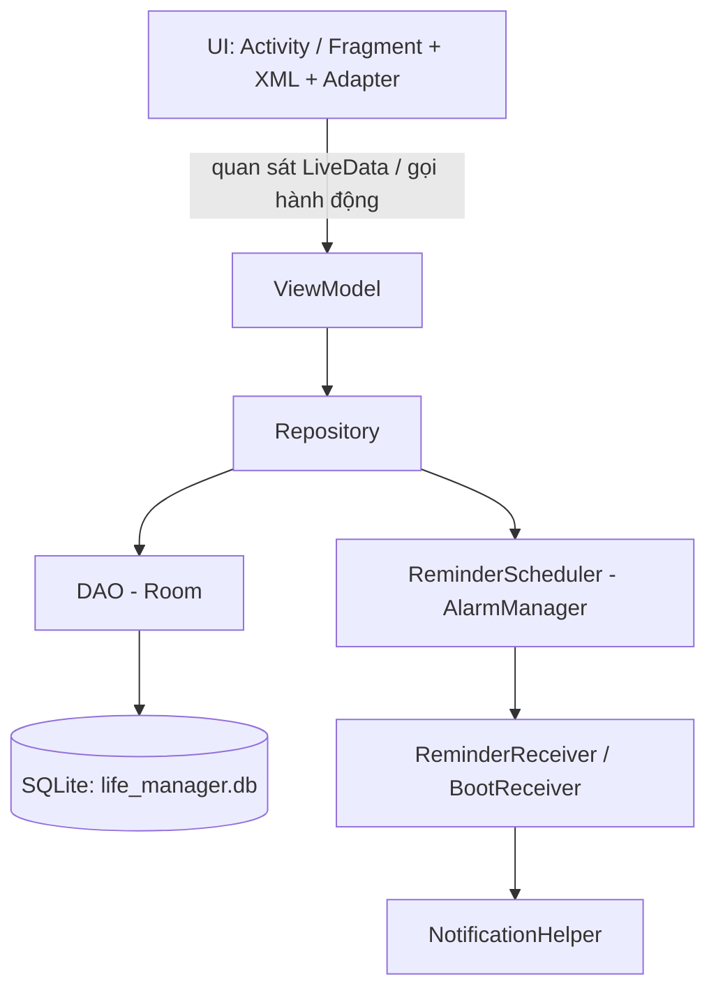
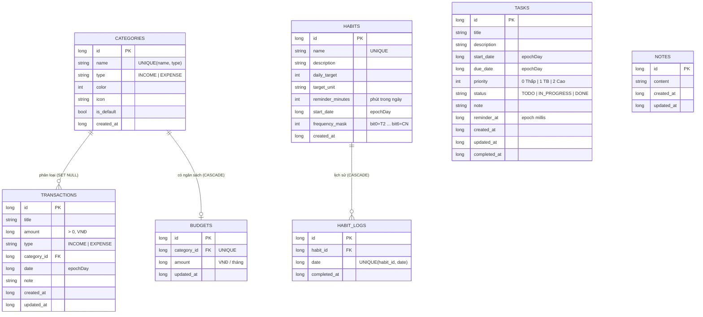

# Life-Manager — Quản lý cuộc sống cá nhân (Android · Java)

Ứng dụng Android quản lý **tài chính, công việc, thói quen** và **ghi chú** trong một nền tảng duy nhất.

| Hạng mục | Công nghệ |
|---|---|
| Ngôn ngữ | Java 17 (100% Java, không Kotlin) |
| Build | Gradle 9.3.1 (Groovy `build.gradle`), Android Gradle Plugin 9.1.0 |
| SDK | `minSdk 26` (Android 8.0) · `targetSdk 36` · `compileSdk 36` |
| Giao diện | XML Layout + Material Design 3 + ViewBinding |
| Kiến trúc | MVVM (Entity → DAO → Database → Repository → ViewModel → Activity/Fragment) |
| Dữ liệu | Room 2.8.4 (SQLite) |
| Biểu đồ | MPAndroidChart v3.1.0 |
| Khác | RecyclerView, LiveData, SharedPreferences, AlarmManager + Notification, Java Time API |

---

## Giai đoạn 1 — Phân tích yêu cầu & Use Case

**Tác nhân:** Người dùng · Hệ thống (AlarmManager gửi thông báo nhắc nhở).

| Module | Use Case chính |
|---|---|
| Tài khoản | Đăng ký (tên hiển thị, tên đăng nhập, mật khẩu) · Đăng nhập · Đăng xuất · Tạm khóa 30 giây sau 5 lần nhập sai · Mỗi tài khoản có dữ liệu riêng |
| Trang chủ | Xem ngày / thứ tự ngày trong năm · Tích thói quen hôm nay · Tích hoàn thành công việc · Thêm nhanh công việc / thói quen · Ghi chú nhanh (tự động lưu, sửa, xóa) · Xem thống kê nhanh |
| Thu chi | Thêm / sửa / xóa / xem chi tiết giao dịch · Tìm kiếm (không phân biệt dấu) · Lọc theo loại, ngày, tháng, danh mục · Quản lý danh mục (màu, icon) · Đặt ngân sách · Nhận cảnh báo vượt ngân sách |
| Công việc | Bảng Kanban 4 cột · Thêm / sửa / xóa / xem chi tiết · Đổi trạng thái · Đánh dấu hoàn thành · Tìm kiếm · Lọc theo trạng thái & ưu tiên · Sắp xếp theo hạn · Đặt nhắc nhở |
| Thói quen | Thêm / sửa / xóa thói quen · Tích hoàn thành trong ngày · Xem Streak, kỷ lục, tỷ lệ tuần / tháng |
| Báo cáo | Tỷ trọng chi tiêu (biểu đồ tròn) · So sánh ngân sách (biểu đồ cột) · Thống kê công việc · Thống kê thói quen 7 / 30 ngày |
| Cài đặt | Đổi tên hiển thị · Bật / tắt thông báo · Đặt giờ nhắc hằng ngày · Chọn định dạng VNĐ · Xóa toàn bộ dữ liệu · Xem phiên bản |
| Hệ thống | Nhắc tổng hợp hằng ngày · Nhắc công việc theo giờ · Nhắc thói quen theo giờ · Lập lại lịch sau khi khởi động máy |



---

## Giai đoạn 2 — Kiến trúc hệ thống & ERD

### Kiến trúc MVVM



- Mọi truy vấn ghi / đọc đồng bộ chạy trên **một luồng nền duy nhất** (`AppExecutors.diskIO`), kết quả trả về luồng giao diện qua callback.
- Truy vấn đọc trả về **LiveData** của Room → giao diện tự cập nhật khi dữ liệu đổi.
- Chỉ số Streak / tỷ lệ được tính ở background (`HabitSnapshotLiveData`), chỉ phát kết quả mới nhất.
- 4 Fragment của thanh điều hướng được giữ lại bằng `show/hide` (không tạo lại khi chuyển tab).

### ERD



---

## Giai đoạn 3 → 7 — Cấu trúc project

```
LifeManager/
├── build.gradle · settings.gradle · gradle.properties · gradlew(.bat)
└── app/
    ├── build.gradle                      ← toàn bộ dependencies
    └── src/
        ├── main/
        │   ├── AndroidManifest.xml
        │   ├── java/com/example/lifemanager/
        │   │   ├── LifeManagerApp.java · MainActivity.java
        │   │   ├── data/
        │   │   │   ├── entity/      TransactionEntity, Category, Budget, Task, Habit, HabitLog, Note, TransactionType, UserAccount
        │   │   │   ├── dao/         TransactionDao, CategoryDao, BudgetDao, TaskDao, HabitDao, HabitLogDao, NoteDao, UserDao
        │   │   │   ├── database/    AppDatabase (dữ liệu từng tài khoản), AccountDatabase (accounts.db), DatabaseSeeder
        │   │   │   ├── model/       TransactionWithCategory, CategorySpending, HabitWithStats, HabitSnapshot, ...
        │   │   │   └── repository/  AuthRepository, FinanceRepository, TaskRepository, HabitRepository, NoteRepository, SettingsRepository
        │   │   ├── viewmodel/       Auth, Home, Finance, TransactionEditor, Category, Task, TaskEditor, Habit, HabitEditor, Report, Settings
        │   │   ├── ui/              BaseActivity + auth/ home/ finance/ task/ habit/ report/ settings/
        │   │   ├── adapter/         12 RecyclerView Adapter
        │   │   ├── notification/    NotificationHelper, ReminderScheduler, ReminderReceiver, BootReceiver
        │   │   └── utils/           AppExecutors, SessionManager, PasswordHasher, AuthValidator, DateUtils, CurrencyUtils, ...
        │   └── res/  layout/ (33 file) · drawable/ · values/ · menu/ · color/ · mipmap-anydpi/
        └── test/java/com/example/lifemanager/   HabitStatsCalculatorTest, UtilsTest, AuthTest
```

### Quy tắc nghiệp vụ chính

| Quy tắc | Cách thực hiện |
|---|---|
| Số dư | `Tổng thu − Tổng chi` (tháng ở màn Thu Chi; toàn thời gian ở "Số dư hiện tại" Trang chủ) |
| Cảnh báo ngân sách | Sau khi lưu khoản chi, so sánh tổng chi tháng của danh mục với ngân sách → hộp thoại cảnh báo + banner đỏ + thanh tiến độ đỏ |
| Công việc quá hạn | Tự tính: `hạn < hôm nay` **và** chưa hoàn thành → cột "Quá hạn" (không lưu xuống DB) |
| Tỷ lệ hoàn thành công việc | `(hoàn thành / tổng) × 100%` |
| Không ghi trùng thói quen | Unique index `(habit_id, date)` + `OnConflictStrategy.IGNORE` |
| Streak | Chỉ xét ngày có lịch (theo tần suất & ngày bắt đầu). Hôm nay chưa tích **chưa** làm đứt chuỗi; bỏ lỡ một ngày có lịch trong quá khứ → đứt chuỗi. Kỷ lục = chuỗi dài nhất từ ngày bắt đầu. Tính 100% từ `habit_logs` |
| Tỷ lệ tuần / tháng | Số ngày đã tích / số ngày có lịch, từ Thứ Hai (hoặc ngày 1) đến hôm nay |
| Kiểm tra dữ liệu | Tên bắt buộc & giới hạn độ dài · số tiền > 0 và ≤ 1.000 tỷ · hạn ≥ ngày bắt đầu · nhắc nhở phải ở tương lai · tên danh mục / thói quen không trùng (không phân biệt hoa thường) |
| Tài khoản | Tên đăng nhập 4–30 ký tự `[a-z0-9._]`, không phân biệt hoa thường, không trùng · mật khẩu 6–64 ký tự gồm cả chữ và số · mật khẩu chỉ lưu dạng băm **PBKDF2-HMAC-SHA256** (120.000 vòng, salt 16 byte riêng từng tài khoản) · sai 5 lần liên tiếp → khóa đăng nhập 30 giây |
| Dữ liệu theo tài khoản | Mỗi tài khoản một CSDL `life_manager_u<id>.db` và tệp cài đặt riêng; tài khoản đầu tiên tự nhận lại dữ liệu của phiên bản cũ (`life_manager.db`). Đăng xuất hủy lịch nhắc của tài khoản |
| Dữ liệu mặc định | 8 danh mục chi, 4 danh mục thu, 6 ngân sách mẫu, 4 thói quen mặc định. **Không** tạo giao dịch / công việc giả |

---

## Giai đoạn 8 — Kiểm thử

**Unit test (JVM)** — `gradlew :app:testDebugUnitTest` → **19/19 pass**
- `HabitStatsCalculatorTest` (8): chuỗi liên tiếp, hôm nay chưa tích, bỏ lỡ 1 ngày (ví dụ ngày 1–3 hoàn thành, ngày 4 bỏ lỡ), bỏ qua ngày không có lịch, ngày trước ngày bắt đầu, tỷ lệ tuần / tháng.
- `UtilsTest` (6): định dạng & phân tích tiền VNĐ, tìm kiếm không dấu tiếng Việt, xác định quá hạn, tỷ lệ hoàn thành công việc, khoảng ngày của bộ lọc tháng, định dạng ngày tiếng Việt.
- `AuthTest` (5): băm và kiểm tra mật khẩu PBKDF2, salt khác nhau cho kết quả khác nhau, quy tắc tên đăng nhập, mật khẩu, nhập lại mật khẩu và tên hiển thị.

**Android Lint** — `gradlew :app:lintDebug` → **0 lỗi** (còn lại là cảnh báo gợi ý như phiên bản thư viện mới hơn).

**Kiểm thử thủ công trên emulator (Android 37)** — không crash ở tất cả các bước:
- Trang chủ: tích thói quen (Streak tăng lên 1), thêm nhanh công việc, hoàn thành công việc, ghi chú tự động lưu và còn nguyên sau khi buộc dừng app.
- Thu chi: thêm khoản chi 5.200.000 ₫ vào "Ăn uống" → hiện cảnh báo vượt ngân sách 5.000.000 ₫; thêm khoản thu; tổng quan tính đúng số dư; tìm "an uong" ra giao dịch "Ăn uống"; báo lỗi khi chưa chọn danh mục.
- Công việc: Kanban đếm đúng từng cột; công việc ưu tiên Cao được xếp trước.
- Thói quen: thêm thói quen "Thứ 2 – Thứ 6"; chặn trùng tên khác hoa thường.
- Báo cáo: biểu đồ tròn, biểu đồ cột nhóm ngân sách, biểu đồ thói quen 7 ngày hiển thị đúng.
- Cài đặt: đổi định dạng sang "VNĐ" → toàn app cập nhật ngay.
- Tài khoản: đăng ký để trống / nhập lại sai mật khẩu / trùng tên đăng nhập đều báo lỗi đúng ô; tài khoản đầu tiên nhận lại dữ liệu cũ; tài khoản thứ hai có dữ liệu trống riêng; đăng xuất → đăng nhập lại thấy đúng dữ liệu của mình; sai 5 lần bị khóa 30 giây.

---

## Giai đoạn 9 — Build & cài đặt APK

### Cách 1: Android Studio
1. **File → Open** → chọn thư mục `LifeManager` → chờ Gradle Sync xong.
2. Chọn thiết bị / emulator → bấm **Run ▶**.
3. Xuất APK: **Build → Build App Bundle(s) / APK(s) → Build APK(s)**.
4. APK có chữ ký phát hành: **Build → Generate Signed App Bundle / APK → APK** → tạo / chọn keystore → `release`.

### Cách 2: Dòng lệnh (Windows)
```bat
cd LifeManager
gradlew.bat assembleDebug          :: app\build\outputs\apk\debug\app-debug.apk
gradlew.bat testDebugUnitTest      :: chạy unit test
gradlew.bat assembleRelease        :: app\build\outputs\apk\release\app-release-unsigned.apk (cần ký trước khi cài)
adb install -r app\build\outputs\apk\debug\app-debug.apk
```
Yêu cầu: JDK 17+, Android SDK Platform 36. File `local.properties` chứa `sdk.dir` (Android Studio tự tạo; nếu SDK ở chỗ khác hãy sửa lại).

### Ký APK release bằng dòng lệnh
```bat
keytool -genkey -v -keystore lifemanager.jks -keyalg RSA -keysize 2048 -validity 10000 -alias lifemanager
"%ANDROID_HOME%\build-tools\36.0.0\zipalign" -v 4 app-release-unsigned.apk app-release-aligned.apk
"%ANDROID_HOME%\build-tools\36.0.0\apksigner" sign --ks lifemanager.jks --out app-release.apk app-release-aligned.apk
```

---

## Lưu ý

- **Thông báo:** Android 13+ hỏi quyền thông báo khi mở app lần đầu. Trên Android 12+, để nhắc đúng giờ tuyệt đối, vào **Cài đặt → "Cho phép báo thức chính xác"** (nếu không cấp, app vẫn nhắc nhưng có thể lệch vài phút).
- **Tài khoản** chỉ tồn tại trên thiết bị (ứng dụng không dùng Internet); chưa có chức năng khôi phục mật khẩu.
- **Dữ liệu** lưu cục bộ trong `life_manager_u<id>.db` của từng tài khoản, không gửi đi đâu và không bị mất khi đóng app. "Xóa toàn bộ dữ liệu" trong Cài đặt sẽ khôi phục danh mục, ngân sách và thói quen mặc định.
- **Ngân sách** là ngân sách hằng tháng, áp dụng cho mọi tháng.
- Giao diện cố định nền sáng theo bảng màu thiết kế (`#F8F6FC`, `#52648F`, ...).
